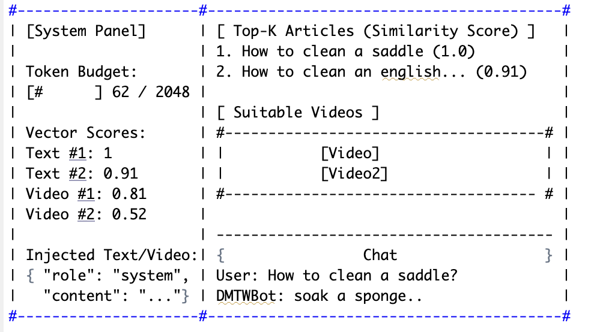

# MARKDOWN FILE FOR PROJECT
Structure of this md file is as follows:
- Structure and pipeline of project
- Project assignment 01
- Project assignment 02

## Structure and pipeline of project
The folder main folder is called Project. It has 4 sub folders, each containing on weekly assignment.
For the code to work in Project assignment 01 (Preprocessing). Both CSV files (available_videos_csv, wikihow-cleaned.csv) has to be within the folder Preprocessing.

1. Run scripts in Preprocessing folder. The order doesn't matter.

## Project assignment 01
This is a screen shot of what we tried to upload in previous assignment.

We have decided to create a arg parser so that we are flexible with the input files
to run on Windows Powershell: 
python howTo100M_preprocessing.py `
  --task-ids-csv pathTo/task_ids.csv ` 
  --available-videos-csv pathTo/available_videos.csv `
  --videos-root pathTo/videos `
  --limit-videos 5 `
  --query "how to boil a water"

## Project assignment 02
How your chatbot architecture can later be adapted to:
– inject retrieved how-to article text into the context block,
  There is a comment about this in the code. So the variable context_block is created but so far just an empty string. In the prompt construction function, it checks whether you have a context or not. The context is then retrieved by calling the function as implemented in project assignment 01. However, since the articles are possibly longer than the max token (2048) we have, we might have to update it so that the context is a summarised version of the article.
  
– include video metadata or captions,
The video metadata has to be included in the chat bot step as well as it is based on the output that the chat bot is generating.

– control how much retrieved content is passed to the model.
This was mentioned in further up. We have to see if we can summarise the retrieved content. 
  
  
  