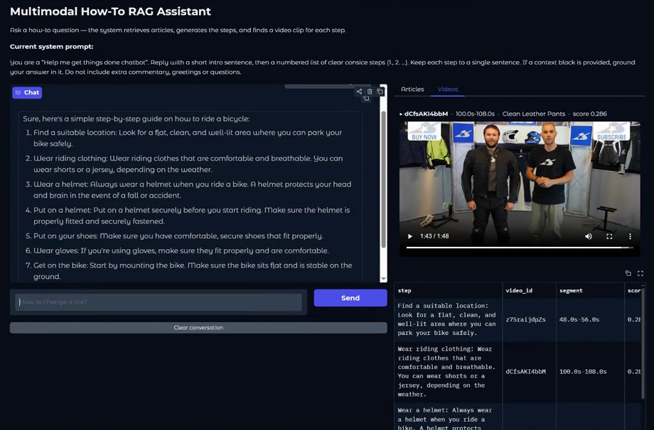

# Multimodal How-To RAG Assistant

A fully local retrieval-augmented chatbot for "how do I…?" questions. For each question it retrieves relevant **WikiHow** articles and uses them as grounding for a small LLM, which writes step-by-step instructions. Then it finds an instructional **HowTo100M** video clip, with timestamps, for every generated step.



🎬 A full demo video is attached to this repository's **Releases** page.

---

## Architecture

```
            User question
                 │
                 ▼
  ┌──────────────────────────────┐      WikiHow  ──►  SQLite (title, summary, text)
  │ ArticleRetriever             │                    + 2 FAISS indices (MiniLM)
  │ MiniLM query embedding       │◄────────────────── title-only  /  title+summary
  │ weighted title + summary     │
  │ search, SQL keyword fallback │
  └──────────────┬───────────────┘
                 │ top-k titles + summaries
                 ▼
  ┌──────────────────────────────┐
  │ Prompt construction          │  <|system|> … <|context|> … <|user|> … <|assistant|>
  │ TinyLlama-1.1B-Chat          │  token-budget tracking, history truncation,
  │ + output validation          │  stopping criteria, role-token leak checks
  └──────────────┬───────────────┘
                 │ numbered steps
                 ▼
  ┌──────────────────────────────┐      HowTo100M ──►  8 s sliding-window clips (4 s stride)
  │ VideoRetriever               │                    4 frames/clip → CLIP ViT-B/32 → mean
  │ CLIP text embedding per step │◄────────────────── FAISS IndexIDMap2 + SQLite clip metadata
  └──────────────┬───────────────┘
                 │ (video_id, start–end, score) per step
                 ▼
        Gradio UI: chat · article list · video player + playlist · system inspection
```

### Components

| Module | Responsibility |
|---|---|
| `Preprocessing/wikihow_text_preprocessing.py` | Streams the WikiHow CSV in chunks into SQLite and builds two L2-normalized FAISS inner-product indices (`all-MiniLM-L6-v2`): one over titles, one over titles + summaries |
| `Preprocessing/howTo100M_preprocessing.py` | Splits each video into sliding-window clips with OpenCV, embeds sampled frames with CLIP ViT-B/32, and stores the clip vectors in FAISS with their metadata (video, task, time segment) in SQLite. Configurable from the CLI. |
| `Chatbot/model_setup.py` | Chatbot core: prompt construction with explicit role delimiters, conversation history, token counting and truncation, stopping criteria, output validation |
| `Retrieval/article_retriever.py` | `ArticleRetriever`: weighted fusion of both indices, metadata lookup, keyword fallback, and formatting of the context snippet |
| `Retrieval/video_retriever.py` | `VideoRetriever`: CLIP text → clip search, returning video IDs, time segments and similarity scores |
| `Retrieval/rag_pipeline.py` | `RAGPipeline`: article retrieval → prompt → generation → step parsing → one clip per step |
| `Retrieval/app.py` | Gradio interface with chat state, an article tab, a video player that seeks to the selected segment, and a collapsible **System inspection** panel (token budget, similarity scores, injected context) |

All models are used frozen, for inference only. The whole system runs locally.

---

## Setup

```bash
python -m venv venv
venv\Scripts\activate                    # Windows (source venv/bin/activate on Linux/macOS)
pip install -r requirements.txt
```

### Data
The datasets are not included. Create `Preprocessing/data/` and place inside it:
- `wikihow-cleaned/wikihow-cleaned.csv`: the cleaned WikiHow dataset
- `howto100m_bundle/`: the HowTo100M subset (342 videos) with `videos/`, `available_videos.csv` and `task_ids.csv`

### Build the indices (one-time)
```bash
# 1) WikiHow articles: run from inside Preprocessing/
cd Preprocessing
python wikihow_text_preprocessing.py
cd ..

# 2) HowTo100M clips: run from the project folder
python Preprocessing/howTo100M_preprocessing.py \
  --db-path Preprocessing/processed-data/howto100m_clips.sqlite3 \
  --index-path Preprocessing/processed-data/howto100m_clips.faiss \
  --query "how to boil water"          # optional: --limit-videos 5 for a quick test
```
On Windows PowerShell, write the command on one line or use `` ` `` instead of `\` for line continuation.
This creates `Preprocessing/processed-data/` with `wikihow.db`, `title_index.faiss`, `combined_index.faiss` and the clip index and database.

### Run the app
```bash
cd Retrieval
python app.py
```
Open the local Gradio URL, ask something like *"How to change a tire?"*, and open **System inspection** at the bottom to see what was retrieved and injected into the prompt.

---

## Design notes
- **Two article indices.** Titles match short intent-style queries well, and title + summary adds semantic detail. The scores are fused with a configurable `title_weight`.
- **Step-level video retrieval.** The steps the LLM generates are short, visual sentences. They make better CLIP queries than the user's raw question, so each step gets its own clip.
- **Context budget.** TinyLlama has a 2,048-token window. Only titles and summaries are injected, never full articles, and 256 tokens are reserved for generation. Older turns are truncated when the budget runs out.
- **The interface changed during development.** The original sketch ([`Plan_of_interface.png`](Plan_of_interface.png)) had all panels visible at once. The final UI moves inspection and media into tabs and a collapsible panel to keep the focus on the chat.

## Limitations
- TinyLlama sometimes repeats or invents steps. A larger instruction-tuned model would improve the answers.
- CLIP matches what a clip *looks like*, not what is said in it, so some clips are only loosely related to their step. Adding transcripts or captions would help.
